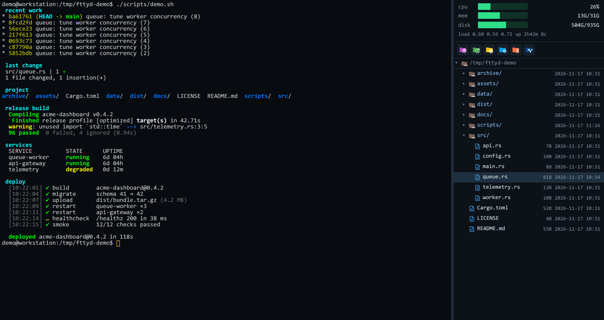
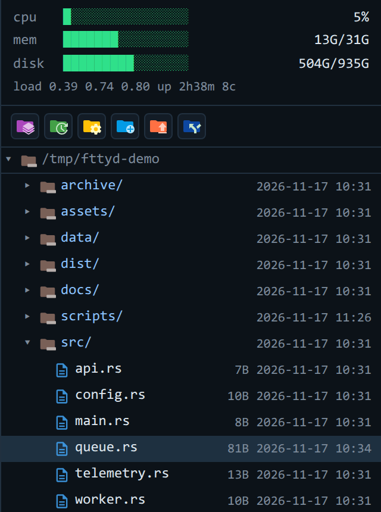
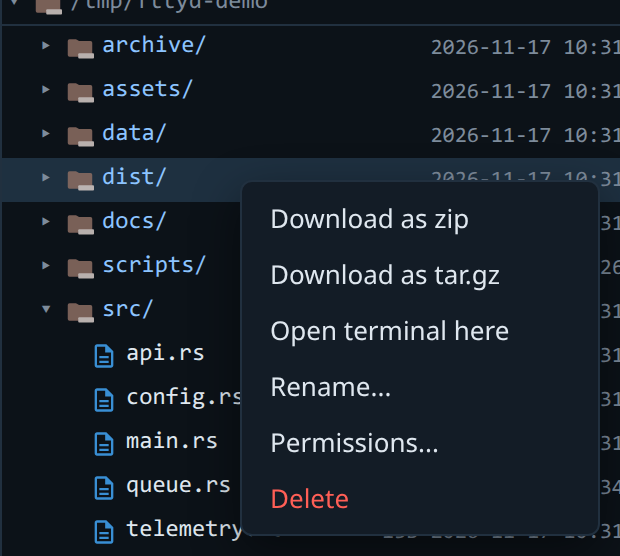
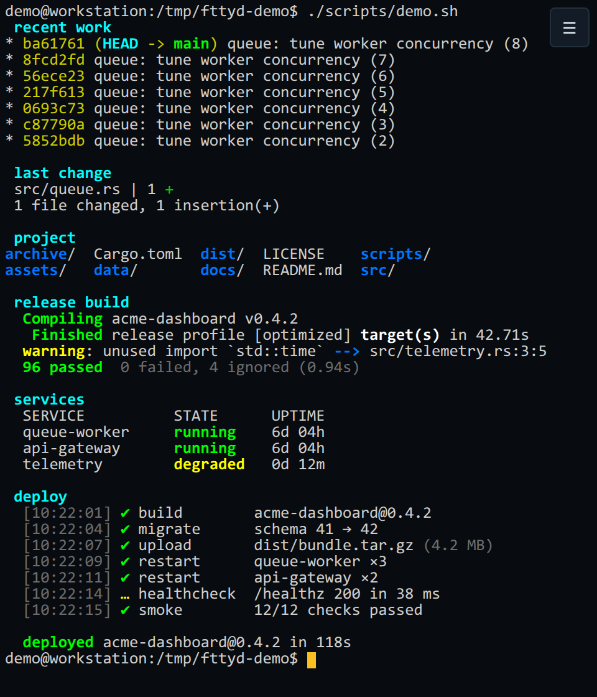

# fttyd

[](https://github.com/Foorack/fttyd/actions/workflows/ci.yml)
[](https://crates.io/crates/fttyd)
[](#license)

**A web terminal in one static binary — with the file manager ttyd never had.**

fttyd is a drop-in replacement for [ttyd](https://github.com/tsl0922/ttyd): the same flags, the same
wire protocol, the same endpoints, so `ttyd` → `fttyd` in an existing deployment changes nothing else.
On top of that it gives you a sidebar with live system gauges and a real file tree you can browse,
drag files onto, download as a zip, and rename or delete — without a second service, a second port, or
an asset directory.



## Why another one

ttyd is excellent and it is finished: it gives you a terminal in a browser and nothing else. Every
deployment then grows the same bolt-ons — something to get a log file out, something to see whether
the box is about to run out of disk, something to look around the filesystem without typing `ls`
forty times.

fttyd puts those in the same binary, behind the same authentication, under the same `-W` switch, and
keeps the protocol identical so ttyd's own client still works against it. A conformance test runs
ttyd's shipped frontend bundle against this server to prove that, rather than asserting it.

## What you get

| Capability | What it does |
|---|---|
| **Terminal** | xterm.js with WebGL, correct resize, flow control, reconnect, `-t` client options, unicode 11, clickable links |
| **Gauges** | CPU, memory, disk and load, sampled host-wide once a second and pushed over SSE; the numeric value sits beside every bar |
| **File tree** | lazy loading, keyboard navigation, hidden-file toggle, sizes and mtimes, symlinks marked, unreadable directories padlocked rather than hidden |
| **Follow the shell** | the tree tracks the shell's working directory, so `cd` in the terminal moves the tree; navigating by hand pins it, and ◎ jumps back |
| **Download** | any file with `Range` support, any folder as a streamed `zip` or `tar.gz` — no temp files, ZIP64, permissions and mtimes preserved |
| **Upload** | chunked and resumable, free-space checked, drag-and-drop from the desktop including folders, atomic rename when the last chunk lands |
| **Edit** | new folder, rename, permissions, delete, and "open terminal here" which types the `cd` for you |
| **Drop-in** | every ttyd flag, base paths, UNIX sockets, IPv6, `-u`/`-g`, TLS with optional client certificates, `-I`, `-O`, `-a`, `-B` |
| **One thing to deploy** | a single binary with the frontend embedded; no runtime assets, no Node, no network calls |

<p align="center">
  
  
</p>

On a narrow screen the sidebar becomes a drawer and the terminal keeps the full width:

<p align="center">
  
</p>

## Install

**Static binary** — Linux, no libc, runs on alpine or `scratch`. Take the tarball for your
architecture from the [latest release](https://github.com/Foorack/fttyd/releases/latest), which also
publishes a `SHA256SUMS`:

```sh
curl -LO https://github.com/Foorack/fttyd/releases/latest/download/fttyd-0.1.1-x86_64-unknown-linux-musl.tar.gz
tar xzf fttyd-0.1.1-x86_64-unknown-linux-musl.tar.gz
sudo install -m755 fttyd-0.1.1-x86_64-unknown-linux-musl/fttyd /usr/local/bin/
```

`aarch64-unknown-linux-musl` is published the same way. That is the whole story for now: those two
Linux targets. There are no Windows or macOS binaries.

**Cargo** — the crate ships the built frontend, so this needs no Node toolchain:

```sh
cargo install fttyd
```

**From source** — needs [bun](https://bun.sh) (or npm), because `build.rs` compiles the frontend into
the binary:

```sh
git clone https://github.com/Foorack/fttyd && cd fttyd
cargo build --release          # target/release/fttyd
```

## Run

```sh
fttyd bash -l                              # read-only: a terminal you can type in, nothing more
fttyd -W --file-root /srv /bin/bash -l     # uploads and deletes, tree confined to /srv
fttyd -p 8080 -c user:pass -W bash -l      # basic auth on port 8080
fttyd -i 127.0.0.1 -W bash -l              # loopback only, behind your own proxy
```

Then open `http://localhost:7681`. The command after the flags is exactly what ttyd would run, so
anything that works there works here — including the per-connection child process.

Two flags are additions; everything else is ttyd's:

| Flag | Effect |
|---|---|
| `-W` | the switch ttyd already uses for terminal input; here it also unlocks uploads, renames and deletes. Without it every mutating request is refused |
| `--file-root DIR` | repeatable; confines the file API to `DIR`. Without it the tree reaches whatever the server process can, which is the same reach as the terminal beside it |

`fttyd --help` prints the rest, and it is the same list ttyd prints — differing only in the program
name, the version and `--file-root`.

The sidebar itself:

- **Walking up** — the tree is not anchored to the directory the server started in. Each ↑ asks the
  server for the parent and rebases one level, keeping what you had expanded, all the way to `/`, and
  a confined `--file-root` stops it at the boundary with an explanation.
- **Downloads** — a folder download of a tree containing unreadable or special files still succeeds;
  whatever was skipped is listed in `fttyd-archive-report.txt` inside the archive. Archives store
  symlinks as links and never follow them.
- **Non-UTF-8 names** cannot be addressed over JSON, so the status line says how many entries were
  omitted instead of hiding them silently.
- **Ctrl+C stops the server** even with sessions open: websockets get a `1001` close frame and the
  stats stream ends, rather than waiting for browser tabs to go away.

## Security, briefly

There is no new authentication system. `-c` and `-H` do exactly what they do in ttyd, because the
perimeter belongs to your reverse proxy. What fttyd adds is that the file API is **read-only unless
`-W`**, and that every non-GET request must carry a header whose value comes from `/token` — which a
cross-origin page cannot set, because there is no CORS policy to approve the preflight. With `-H`,
mutations are also logged with the authenticated actor: `file op: <op> <path> actor=<header value>`.

The terminal is an unconstrained shell for whoever is allowed in, and the file API runs with the
server's privileges — it cannot `sudo` the way an interactive shell can, so root-owned paths are
listed as locked with the real error. `--file-root` confines the file API; it is not a jail for the
shell and not a substitute for authentication. See [SECURITY.md](SECURITY.md).

## Compatibility with ttyd

Same `1<title>`/`2<prefs>` handshake, same frame bytes, same close codes, same `/token` behaviour,
same `-t` option keys, same `-I` escape hatch. The conformance test drives ttyd's own built client
against fttyd; if it ever fails, compatibility is broken and that is a bug.

Three additions ttyd's client cannot see: the `/api/*` endpoints, one extra `3` frame carrying the
shell's working directory, and `/favicon.svg`. The deliberate divergences — unknown options are an
error rather than logged and ignored, numbers with trailing garbage are rejected, `--` is implied,
`-t` takes one `key=value` per occurrence — are listed in
[docs/ARCHITECTURE.md](docs/ARCHITECTURE.md#divergences-from-ttyd), along with the reasoning for every
one of them.

## Development

```sh
cargo test                                          # Rust unit and integration tests
(cd e2e && bun install && bunx playwright test)     # drives the real binary in Chromium
./scripts/docker-tests.sh                           # privileges, sockets, special files
```

CI runs all three on every push. [CONTRIBUTING.md](CONTRIBUTING.md) covers sending a change,
[docs/ARCHITECTURE.md](docs/ARCHITECTURE.md) covers how the code is laid out, and [PLAN.md](PLAN.md)
holds the design rationale and the record of what was verified how.

## License

MIT. ttyd is MIT as well; the wire protocol and flag surface are reimplemented from its behaviour,
and its shipped client is used only as a test fixture. The sidebar icons come from
[Material Icon Theme](https://github.com/material-extensions/vscode-material-icon-theme) (MIT), whose
licence sits in [web/src/icons/](web/src/icons/).
